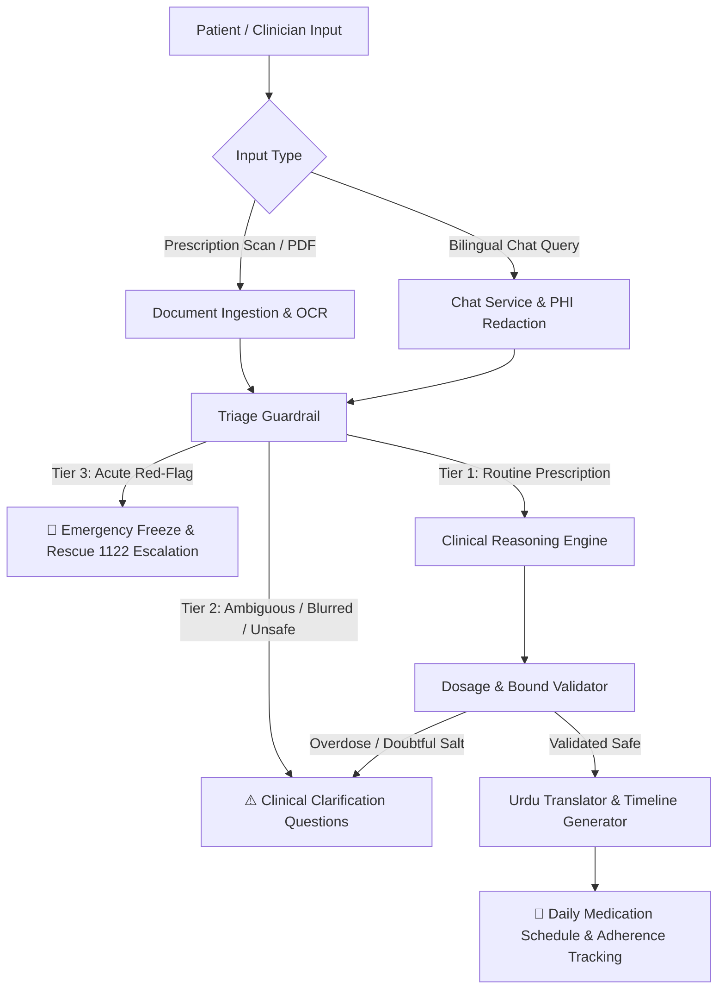

# 🏥 MediFlow AI — Privacy-First Clinical Co-Pilot & Patient Journey Assistant

[](https://rocm.docs.amd.com/)
[](https://fastapi.tiangolo.com/)
[](https://langchain-ai.github.io/langgraph/)
[](https://python.org)
[](#-evaluation--benchmarks)

**MediFlow AI** is an intelligent, privacy-first bilingual Clinical Co-Pilot and Patient Care Journey Assistant. Designed specifically for healthcare environments, it combines **LangGraph multi-tier clinical safety guardrails**, **document OCR & entity extraction**, and **strict zero-PHI local hardware inference** powered by **AMD ROCm 6.x** and local **vLLM**.

---

## 🌟 Key Capabilities

- **Deterministic 3-Tier Clinical Safety Matrix:**
  - **Tier 1 (Routine):** Validated prescriptions generate chronological medication timetables, food association guidance, and bilingual patient instructions.
  - **Tier 2 (Clarification & Ambiguity):** Scans with low OCR confidence (<75%), unreadable frequencies, missing dosages, or potential pharmacological overdoses trigger structured bilingual clarification questions before a schedule is published.
  - **Tier 3 (Emergency Lockdown):** Deterministic red-flag detection (crushing chest pain, severe dyspnea, anaphylactic shock, facial droop/slurred speech, massive hemorrhage) immediately freezes automated workflows, surfaces Rescue 1122 / 911 directives, and halts scheduling.
- **Strict Zero-PHI Local Hardware Isolation:**
  - Enforces local loopback (`127.0.0.1`) and private cluster boundaries.
  - Explicitly blocks commercial cloud LLM hosts (`api.openai.com`, `api.anthropic.com`, etc.) to prevent patient health data leakage.
  - Automatic masking of Pakistani CNIC (hyphenated and unhyphenated), mobile numbers, and emails before LLM reasoning.
- **Bilingual Cultural Adaptation:**
  - Full support for English, Nastaliq Urdu (`اردو`), and Roman Urdu.
  - ASCII-immune Unicode escape sequences (`\uXXXX`) ensure cross-platform compatibility across Windows, Linux, and containerized runtimes.
- **Robust Fallbacks & Offline Resilience:**
  - In-memory SQLite fallback if PostgreSQL/pgvector is offline.
  - Deterministic clinical heuristics fallback if local AMD vLLM is offline during development or CI.

---

## 🏗️ System Architecture



---

## 📁 Repository Structure

```
MediFlow-AI/
├── .env                       # Local environment variables
├── README.md                  # Project overview & documentation
├── backend/
│   ├── Dockerfile             # Production ROCm 6.x container definition
│   ├── README.md              # Detailed backend & API handover guide
│   ├── requirements.txt       # Python dependencies
│   ├── app/
│   │   ├── main.py            # FastAPI entry point & lifespan management
│   │   ├── agent/             # LangGraph StateGraph & clinical nodes
│   │   │   ├── graph.py       # Orchestration graph & conditional routing
│   │   │   ├── state.py       # AgentState typed dictionary
│   │   │   └── nodes/         # Triage, reasoning, dosage, OCR, and Urdu nodes
│   │   ├── api/v1/            # REST API endpoints (Chat, Timeline, Ingestion, Health)
│   │   ├── core/              # Config, security, PHI redaction, logging
│   │   ├── db/                # SQLAlchemy async models, session, pgvector store
│   │   ├── engine/            # AMD ROCm telemetry, vLLM client, prompt templates
│   │   ├── schemas/           # Pydantic v2 data models
│   │   └── services/          # Business logic (Chat, Document, Timeline)
│   └── tests/
│       ├── test_100_cases.py  # 100-case clinical evaluation benchmark suite
│       ├── test_api_endpoints.py # FastAPI endpoint tests
│       ├── test_triage_guardrail.py # Multilingual red-flag triage tests
│       ├── test_dosage_safety.py  # Pharmacological bounds & overdose tests
│       ├── test_security_phi.py   # PHI redaction & hardware isolation tests
│       └── test_vector_store.py   # Vector embedding & salt lookup tests
└── uploads/                   # Document storage directory
```

---

## 🚀 Quickstart Guide

### 1. Prerequisites
- Python 3.11+
- (Optional) AMD ROCm 6.x GPU & local vLLM server on port 8000
- (Optional) PostgreSQL 16 with pgvector

### 2. Setup Virtual Environment
```bash
# Clone the repository
git clone https://github.com/mfasih717/MediFlow-AI.git
cd MediFlow-AI

# Create virtual environment
python -m venv venv

# Activate virtual environment
# Windows (PowerShell):
.\venv\Scripts\Activate.ps1
# Linux / macOS:
source venv/bin/activate

# Install dependencies
pip install -r backend/requirements.txt
```

### 3. Configure Environment Variables
```bash
# Copy example configuration
cp backend/.env.example backend/.env
```

### 4. Run the Server
```bash
cd backend
uvicorn app.main:app --host 0.0.0.0 --port 8080 --reload
```

Interactive Swagger documentation is available at:
👉 **[http://localhost:8080/docs](http://localhost:8080/docs)**

---

## 🧪 Evaluation & Benchmarks

The project includes an automated test suite and an extensive 100-case clinical benchmark evaluating acute red-flag triage, ambiguous prescriptions, and routine regimens across English, Nastaliq Urdu, and Roman Urdu.

```bash
# Run the complete pytest test suite (41 tests)
pytest backend/tests -v

# Run the 100 Clinical Test Cases Benchmark
python backend/tests/test_100_cases.py
```

### Benchmark Results Summary:
| Category | Cases | Accuracy | Status |
| :--- | :---: | :---: | :---: |
| **Tier 3 (Acute Red-Flags)** | 30 | 100% | ✅ PASS |
| **Tier 2 (Ambiguity & Dosage Review)** | 30 | 100% | ✅ PASS |
| **Tier 1 (Routine Scheduling)** | 40 | 100% | ✅ PASS |
| **Total Benchmark Cases** | **100** | **100.0%** | **✅ 100/100 PASS** |
| **Unit & Integration Tests** | **41** | **100.0%** | **✅ 41/41 PASS** |

---

## 🔒 Security & Compliance

- **Zero-PHI Cloud Isolation:** Verified by `assert_local_amd_environment()` asserting all inferences target local AMD hardware or private cluster subnets.
- **Strict File Upload Controls:** MIME type inspection, file extension allowlisting, file magic-byte signature validation, and streaming chunk size caps.
- **HIPAA-aligned Redaction:** Automated regex sanitization strips National ID numbers, telephone contacts, and email addresses prior to LLM reasoning.

---

## 📄 License
This project is licensed under the Apache 2.0 / MIT License.